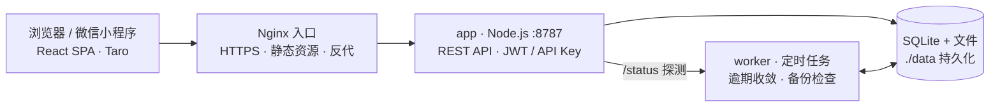

# 科协运营管理平台

面向高校学生科协的一体化运营管理系统：设备与 3D 打印预约、耗材与元器件库存、仪器借还、门禁、活动、值班、资料归档，以及经费台账。支持细粒度权限、操作审计、数据备份与外部 API 调用。

- 后端：Node.js 22.5+（内置 `node:sqlite`）+ Express 4
- 前端：React 18 + Vite 6
- 部署：Docker Compose（应用 + 维护进程 + Nginx），数据落盘持久化

## 功能

| 模块 | 内容 |
|---|---|
| 设备预约 | 设备台账与自定义类型分板块、时段冲突校验、预约审核、完成/取消、维护记录、设备日志 Excel 导出 |
| 3D 打印 | 打印任务登记、材料与耗时记录、状态流转 |
| 耗材库存 | 耗材入库/领用/盘点、低库存提醒 |
| 元器件库存 | 元器件分类、出入库、库存预警 |
| 仪器借还 | 借出/归还、逾期自动标记 |
| 门禁 | 门禁申请、审批、授权与进出登记、到期自动失效 |
| 活动 | 活动发布、报名、签到、Excel 批量导入 |
| 值班 | 排班、签到、Excel 批量导入 |
| 资料归档 | 文件上传、分类、版本、下载 |
| 经费台账 | 收入/支出、分类管理、收款台账与凭证审核、Excel/ZIP 导出 |
| 成员与权限 | 管理员/成员两种角色 + 8 项可勾选权限、批量建号、**Excel 名单导入自动建号与初始密码**、密码重置、操作审计 |
| 开放接口 | API Key 签发与撤销、单密钥限流、CORS 白名单 |

## 架构



```text
浏览器 ──HTTPS :443──> 宿主机 Nginx ──> 容器 Nginx :8080 ──> app(Node) :8787 ──> SQLite(./data)
                              │
                              └── HTTP /status ──> worker(Node) :8788 ──> 同一数据卷 /data
```

- **app**：提供 REST API 与前端静态资源。
- **worker**：独立维护容器，每 60 秒收敛逾期借用、过期门禁、结束预约，并检查每日备份。
- **nginx**：统一入口与反向代理，容器间通过 Compose 服务名发现。
- 健康检查：`app`、`worker`、`nginx` 均配置 `healthcheck`，`restart: unless-stopped` 支持故障自恢复。

## 快速开始（Docker）

前置：Docker 24+、Docker Compose v2。

```bash
# 可选：生产环境建议显式指定密钥与站点来源
cat > .env <<'EOF'
JWT_SECRET=请替换为随机长字符串
CORS_ORIGINS=https://astmgr.icu
COOKIE_SECURE=1
WX_APPID=
WX_SECRET=
EOF

docker compose up -d --build
docker compose ps
docker compose logs -f app
```

访问 <http://localhost:8080>（容器 Nginx 绑定宿主机 8080，可直接使用，也可在前面再挂一层宿主机 Nginx 终止 TLS）。数据持久化在项目根目录 `./data`，备份时直接打包该目录即可。

初始管理员：`admin / Admin@123456`，首次登录强制修改密码（执行 `seed:demo` 后统一改为 `Kx@2026demo`，见下节）。

> **评测环境可用性说明（HTTPS 与微信小程序）**
> - 演示地址为 `http://1.14.125.216/`（IP 直连）。域名 `astmgr.icu` 的 HTTPS 证书已签发、Nginx 443 已配置，但因 **ICP 备案在截止前来不及完成**，域名链路被拦截，本次评测暂以 HTTP + IP 提供，口令与令牌在链路上未加密，仅限评测使用。
> - **微信小程序暂不可用**：未备案域名无法配置为 request 合法域名，且小程序尚未发布。`miniapp/` 源码与 H5 预览保留，备案完成后把 `miniapp/src/config.ts` 的 `API_BASE_URL` 改为 HTTPS 域名即可启用，后端无需改动。
> - 生产部署完成备案后，将 `CORS_ORIGINS` 改为 HTTPS 域名并设 `COOKIE_SECURE=1`，即恢复全加密访问。

### 载入演示数据

```bash
docker compose exec app npm run seed:demo
```

| 账号 | 密码 | 权限 |
|---|---|---|
| `admin` | `Kx@2026demo` | 管理员（全部权限） |
| `finance01` | `Kx@2026demo` | 经费台账（收入/支出） |
| `equip01` | `Kx@2026demo` | 设备、库存 |
| `tech01` | `Kx@2026demo` | 设备、库存、值班、API 调用 |
| `access01` | `Kx@2026demo` | 门禁、值班 |
| `media01` | `Kx@2026demo` | 活动、资料 |

演示数据仅在设备表为空时写入，重复执行不会产生重复记录。

> 为防止遗忘口令导致无法验证，`seed:demo` 每次执行都会把上述账号（含 `admin`）的密码重置为 `Kx@2026demo`，并解除首次登录强制改密。若需自定义口令，登录后在「我的 → 修改密码」中修改即可；再次执行 `seed:demo` 会重新回到统一口令。

### 成员名单导入（自动建号）

「成员管理 → 导入名单」支持用 Excel 名单批量生成账号：

1. 下载模板（`GET /api/v1/imports/members/template`），按表头填写：姓名（必填）、学号、部门、手机、登录账号、角色、权限、可收入/可支出、加入时间。
2. 上传名单（`POST /api/v1/imports/members`，仅管理员），系统自动处理：
   - 登录账号留空时使用学号，学号也为空则自动分配 `kx0001` 起的账号；
   - 权限支持中文写法（经费、设备、库存、门禁、活动、值班、资料、API），多个用顿号/逗号分隔；
   - 每人生成一个随机初始密码（符合密码规则），首次登录强制改密；
   - 已存在账号、缺少姓名、权限无法识别等情况逐行跳过并给出原因，不影响其他行导入。
3. 导入结果页可下载账号表（CSV）分发给成员；初始密码仅在结果中返回一次，审计日志只记录账号不记录密码。

### 本地开发

要求 Node.js ≥ 22.5。

```bash
npm install
npm run dev:server   # 后端 http://localhost:8787
npm run dev:web      # 前端 http://localhost:5173（/api 代理到 8787）
```

其他命令：

```bash
npm test             # Vitest + Supertest 接口测试
npm run lint         # ESLint
npm run build        # 构建前端到 web/dist
npm run seed:demo    # 写入演示数据
```

### 微信小程序

`miniapp/` 是基于 Taro 4 + React + TypeScript 的微信小程序前端，复用同一套 REST API（Bearer 鉴权，无需 Cookie）：

- 页面：登录、首页概览、设备预约、我的预约、库存查询、活动报名、资料下载、我的
- 接口地址在 [miniapp/src/config.ts](./miniapp/src/config.ts) 的 `API_BASE_URL` 中配置，默认 `http://localhost:8787/api/v1`
- 真机/开发者工具调试需在小程序后台把后端域名加入「request 合法域名」；本地联调可临时勾选「不校验合法域名」
- 后端需允许跨域：H5 预览时以 `CORS_ORIGINS=*`（或具体来源）启动，小程序端请求不受微信同源限制
- 微信免密登录：首次用账号密码登录后在「我的 → 微信免密登录」绑定；绑定后小程序启动时用 `wx.login` 的 code 静默换取 JWT，无需再输密码。服务端需配置 `WX_APPID` / `WX_SECRET`（`POST /api/v1/auth/wechat/login`、`/wechat/bind`），openid 存在 `users.wx_openid` 且唯一，一个微信只能绑定一个账号，可随时解绑

## 评测验证指引

以下步骤可在 5 分钟内完成「部署是否成功、核心功能是否可用」的验证，无需额外配置。

**在线演示环境**：<http://1.14.125.216/>（已用 Docker Compose 部署，含演示数据）

1. **健康检查（无需登录）**

```bash
curl http://1.14.125.216/api/v1/health
# {"ok":true,"version":"1.0.0","time":"..."}
```

2. **登录并取得令牌**

```bash
curl -X POST http://1.14.125.216/api/v1/auth/login \
  -H "Content-Type: application/json" \
  -d '{"username":"admin","password":"Kx@2026demo"}'
```

响应中的 `token` 用于后续请求；浏览器直接访问站点时也可用同一账号在页面登录。

3. **运行状态（需管理员）**

```bash
curl -H "Authorization: Bearer <token>" http://1.14.125.216/api/v1/system/status
```

返回应用版本、运行时长、内存占用、数据库大小、worker 在线状态、备份数量与最近备份时间。

4. **审计日志（需管理员）**

```bash
curl -H "Authorization: Bearer <token>" "http://1.14.125.216/api/v1/logs?q=login"
```

页面入口：登录后「设置 → 操作日志」，可按操作类型、操作人、日期与关键字筛选。

5. **日志与进程状态**

```bash
docker compose ps                  # 三个容器的健康状态
docker compose logs -f app         # 应用日志（含请求与错误）
docker compose logs -f worker      # 定时任务日志
docker compose exec app ps -o pid,etime,cmd   # 进程存活与运行时长
```

6. **自动化测试**

```bash
npm test                           # Vitest + Supertest，覆盖鉴权、权限、并发、限流等用例
```

7. **MCP 工具服务**

```bash
KX_API_URL=http://1.14.125.216/api/v1 KX_API_KEY=cfk_xxx \
  node mcp/server.mjs              # 也可在支持 MCP 的客户端中配置，见下文
```

`cfk_xxx` 需先用 `tech01`（或管理员）登录，在「API 管理」中签发。

8. **数据重置**：删除 `./data` 目录后重新 `docker compose up -d`，再执行 `docker compose exec app npm run seed:demo` 即可回到初始演示状态。

## 配置项

| 环境变量 | 默认值 | 说明 |
|---|---|---|
| `PORT` | `8787` | 应用监听端口 |
| `HOST` | `0.0.0.0` | 应用监听地址 |
| `DATA_DIR` | `server/data` | 数据目录（数据库、上传文件、备份） |
| `JWT_SECRET` | 自动生成并保存到 `DATA_DIR/jwt.secret` | JWT 签名密钥，生产环境建议显式指定 |
| `CORS_ORIGINS` | 空（关闭跨域） | 允许跨域的来源，逗号分隔；`*` 表示回显任意来源 |
| `WX_APPID` | 空 | 微信小程序 AppID，用于 `code2session` 免密登录 |
| `WX_SECRET` | 空 | 微信小程序 AppSecret，仅存服务端，切勿写入前端或仓库 |
| `API_RATE_LIMIT` | `120` | 单个 API Key 每分钟调用上限 |
| `WORKER_ENABLED` | 空 | 设为 `1` 时 app 不再启动备份定时器（由 worker 负责） |
| `WORKER_URL` | `http://127.0.0.1:8788` | app 探测 worker 的地址，Compose 中为 `http://worker:8788` |
| `WORKER_PORT` | `8788` | worker 健康检查/状态端口 |
| `WORKER_INTERVAL_MS` | `60000` | worker 维护周期 |
| `NODE_ENV` | `development` | Compose 中为 `production` |
| `TZ` | 系统时区 | Compose 中为 `Asia/Shanghai` |

## 权限模型

角色只有 **管理员** 与 **成员**；成员的运营能力由管理员逐项勾选：

`finance`（经费台账）、`equipment`（设备/打印/维护）、`inventory`（耗材/元器件/借还）、`access`（门禁）、`activity`（活动）、`duty`（值班）、`doc`（资料）、`api`（API 调用）。

- 管理员默认拥有全部权限，不可取消。
- 拥有 `finance` 时还需单独控制「可录入收入 / 可录入支出」，至少保留一项。
- 后端逐接口校验，前端隐藏仅用于体验。
- 旧版本 `role='finance'` 会在启动迁移时自动转为「成员 + `finance` 权限」，接口仍兼容传入该角色。

## 外部 API 调用

1. 管理员在「成员管理」为目标账号勾选「API 调用」权限。
2. 进入「API 管理」签发密钥（明文只显示一次），可设置 1–3650 天有效期。
3. 调用时任选一种请求头：

```bash
curl -H "X-API-Key: cfk_xxxxxxxx" http://localhost:8787/api/v1/auth/me

curl -H "Authorization: ApiKey cfk_xxxxxxxx" http://localhost:8787/api/v1/equipment
```

- 密钥继承持有人的全部权限，并受 `api` 权限约束。
- 单密钥默认 120 次/分钟，超出返回 `429`。
- 撤销、过期或持有人被停用后立即失效。
- 浏览器跨域调用需在 `CORS_ORIGINS` 中登记来源。

## MCP 工具服务

`mcp/server.mjs` 以 MCP（Model Context Protocol）stdio 形式包装了只读查询能力，AI 助手/Agent 可直接调用，底层复用上面的 REST API 与 API Key 鉴权，**零额外依赖**。

提供的工具：`list_equipment`、`list_inventory`、`list_consumables`、`list_activities`、`my_bookings`、`operations_summary`、`search_documents`。

在支持 MCP 的客户端（如 TRAE / Claude Desktop）中这样配置：

```json
{
  "mcpServers": {
    "kx-ops": {
      "command": "node",
      "args": ["/绝对路径/class-fund/mcp/server.mjs"],
      "env": {
        "KX_API_URL": "http://1.14.125.216/api/v1",
        "KX_API_KEY": "cfk_xxxxxxxx"
      }
    }
  }
}
```

- `KX_API_KEY` 需先在「API 管理」签发，且持有人具备 `api` 权限。
- 全部工具为只读查询，写操作仍需回到 Web 界面，避免 Agent 误改数据。

## 数据与备份

- 数据库：`DATA_DIR/classfund.db`（SQLite，WAL 模式）。
- 上传文件：`DATA_DIR/uploads`。
- 备份：`DATA_DIR/backups`，每天自动生成，保留最近 14 天；管理员可在「设置 → 运行状态/数据备份」查看、立即备份或下载。
- Docker 部署时以上目录位于项目根目录 `./data`（挂载为容器内 `/data`），备份直接打包该目录。

## 第三方组件与许可证

直接依赖（均为宽松开源许可证）：

| 组件 | 版本 | 用途 | 许可证 |
|---|---|---|---|
| [express](https://expressjs.com/) | 4.x | Web 框架 | MIT |
| [bcryptjs](https://github.com/dcodeIO/bcrypt.js) | 3.x | 密码哈希 | BSD-3-Clause |
| [jsonwebtoken](https://github.com/auth0/node-jsonwebtoken) | 9.x | JWT 签发与校验 | MIT |
| [cookie-parser](https://github.com/expressjs/cookie-parser) | 1.x | Cookie 解析 | MIT |
| [multer](https://github.com/expressjs/multer) | 2.x | 文件上传 | MIT |
| [exceljs](https://github.com/exceljs/exceljs) | 4.x | Excel 导入/导出 | MIT |
| [archiver](https://github.com/archiverjs/node-archiver) | 7.x | ZIP 打包 | MIT |
| [react](https://react.dev/) / [react-dom](https://react.dev/) | 18.x | 前端框架 | MIT |
| [react-router-dom](https://reactrouter.com/) | 6.x | 前端路由 | MIT |
| [vite](https://vite.dev/) | 6.x | 构建工具 | MIT |
| [vitest](https://vitest.dev/) / [supertest](https://github.com/ladjs/supertest) | 3.x / 7.x | 测试 | MIT |
| [eslint](https://eslint.org/) / [prettier](https://prettier.io/) | 10.x / 3.x | 代码检查与格式化 | MIT |

运行环境与其他镜像：

| 组件 | 用途 | 许可证 |
|---|---|---|
| [Node.js](https://nodejs.org/) 24（`node:24-alpine` 镜像） | 运行时 | MIT |
| [Alpine Linux](https://alpinelinux.org/) | 基础镜像 | MIT 等 |
| [Nginx](https://nginx.org/) 1.27（`nginx:1.27-alpine` 镜像） | 反向代理 | BSD-2-Clause |

Node.js 内置的 `node:sqlite` 随运行时发布，不引入额外原生依赖。以上组件的完整许可证文本见各自发行包中的 `LICENSE` 文件。

## 安全说明

- 密码使用 bcrypt（cost 10）存储；密码规则为 8–64 位且同时包含字母与数字。
- JWT 有效期 7 天，`token_version` 机制保证改密/重置后旧 token 立即失效。
- 登录失败按「IP + 账号」限流：15 分钟内 5 次失败后返回 `429`，记录持久化到数据库。
- API Key 仅存 SHA-256 摘要，支持有效期、撤销、最近使用时间与单独限流。
- 上传与下载均需登录鉴权；响应附带 `X-Content-Type-Options`、`X-Frame-Options` 等安全头。
- 全部敏感操作写入审计日志（成员变更、权限调整、备份、密钥、导出等）。

## 目录结构

```text
class-fund/
├── server/src/          # 后端：app.js、db.js、auth.js、backup.js、worker.js、routes/
├── web/src/             # 前端：pages/、components/、api.js、App.jsx
├── miniapp/             # 微信小程序（Taro + React + TS）
├── mcp/server.mjs       # MCP 工具服务（stdio，只读查询）
├── tests/api.test.js    # 接口自动化测试
├── docs/项目手册.md      # 开发/运维手册
├── docs/设计报告.docx    # 设计报告（Word 版，可编辑）
├── docs/设计报告.html    # 设计报告源文件（用于导出 Word / PDF）
├── docs/设计报告.pdf     # 设计报告（导出版，便于直接查看）
├── docs/作品介绍-一页纸.pdf
├── deploy/              # Nginx 配置
├── Dockerfile
└── docker-compose.yml
```

## 版本记录

见 [CHANGELOG.md](./CHANGELOG.md)。

## 许可证

本项目采用 [Apache License 2.0](./LICENSE)。
